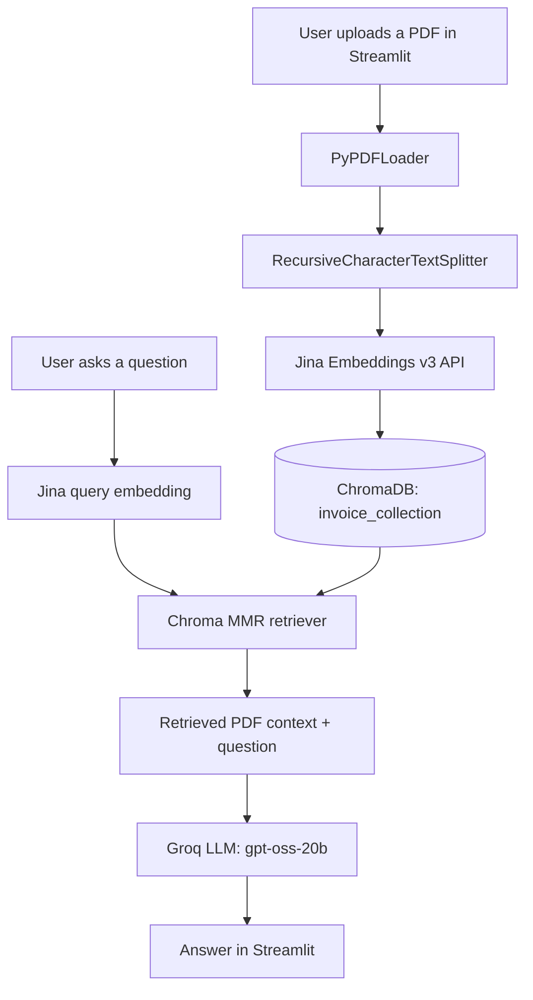
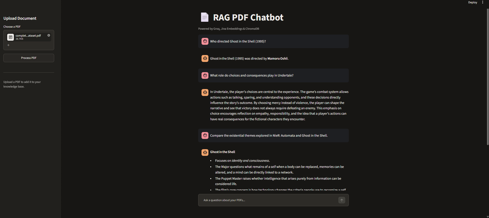

# RAG PDF Chatbot

A Streamlit-based **Retrieval-Augmented Generation (RAG)** application for asking questions about PDF documents. PDF text is split into chunks, embedded with Jina AI, indexed in ChromaDB, retrieved using MMR, and supplied to a Groq-hosted language model for grounded answers.

> **Repository status:** This README reflects the `app.py` and PDF-indexing script shared in chat. Other scripts (`main.py`, `vectordb/db.py`, `test_retrieval.py`) have not been fully reviewed.

## Features

- Question answering grounded in retrieved PDF passages
- PDF upload, duplicate detection by SHA-256 hash, chunking and embedding on **Process PDF**
- Persistent local vector store using ChromaDB
- Streamlit user interface
- Groq-hosted `openai/gpt-oss-20b` model and Jina `jina-embeddings-v3`

## Architecture



## Dashboard screenshot

This is the **exact screenshot provided by the project owner**, not an AI-generated mockup. It shows the dark-themed Streamlit UI with a PDF selected, questions, and grounded answers. Streamlit theme/browser zoom can change how the interface appears on other machines.



## Project structure

```text
RAG PROJECT/
├── app.py                   # Streamlit application
├── main.py                  # Terminal-based RAG example
├── create_db.py             # Chroma indexing script
├── test_retrieval.py        # Retrieval troubleshooting
├── vectordb/
│   └── db.py                # Review actual responsibilities
├── doc loader/              # Optional document loader scripts
├── docs/
│   ├── architecture.mmd
│   └── screenshots/
│       └── dashboard.png    # Actual Streamlit screenshot
├── requirements.txt
├── .env.example
├── .gitignore
├── SECURITY.md
└── README.md

# Deliberately NOT committed: .env, chroma db/, uploaded PDFs, venv/
```

## Local setup (Windows / PowerShell)

### 1. Clone the repository

```powershell
git clone https://github.com/YOUR_USERNAME/RAG-PDF-Chatbot.git
cd RAG-PDF-Chatbot
```

### 2. Create and activate a Python virtual environment

```powershell
py -3.12 -m venv .venv
.\.venv\Scripts\Activate.ps1
```

### 3. Install dependencies

```powershell
python -m pip install --upgrade pip
python -m pip install -r requirements.txt
```

### 4. Configure environment variables

Copy `.env.example` to `.env` and add your own API keys:

```powershell
Copy-Item .env.example .env
```

```dotenv
GROQ_API_KEY=your_own_groq_key
JINA_API_KEY=your_own_jina_key
```

**Required small code change before publishing:** Your shared `app.py` currently uses `BASE_DIR.parent / ".env"`, but this README uses `.env` inside the repository root. In `app.py`, change `ENV_PATH` to `BASE_DIR / ".env"`. In your indexing script, change `Path(__file__).resolve().parents[1]` to `Path(__file__).resolve().parent`. For scripts in the repository root, use:

```python
from pathlib import Path
from dotenv import load_dotenv
load_dotenv(Path(__file__).resolve().parent / ".env")
```

Never commit real credentials. Both scripts must agree on where `.env` is located.

### 5. Launch the Streamlit app

```powershell
python -m streamlit run app.py
```

Streamlit normally opens the app at http://localhost:8501.

### 6. Try the app

Upload a PDF containing selectable text, click **Process PDF**, and ask a question supported by the document. A fresh clone starts without a populated `chroma db/` directory. The database should be created when your indexing flow runs.

The shared `create_db.py` uses a hard-coded `peakfiction.pdf`, so that script will fail in a fresh clone unless you provide an appropriately licensed file at that path or modify the code. For general setup, uploading a PDF in the Streamlit sidebar is sufficient. To use the standalone script:

```powershell
python create_db.py
```

**Do not assume the test PDF is included**: PDFs are ignored by default to avoid distributing copyrighted or private material.

## Retrieval configuration

The shared `app.py` uses the Chroma collection `invoice_collection`, Jina `jina-embeddings-v3`, and an MMR retriever with `k=5`, `fetch_k=15`, and `lambda_mult=0.7`. It splits uploaded PDFs using `chunk_size=500` and `chunk_overlap=100`. The standalone indexing script instead uses `chunk_size=1000` and `chunk_overlap=200`; consider standardizing settings for consistency. Keep collection names, embedding settings, and the database directory consistent between indexing and retrieval scripts.

## Troubleshooting

| Symptom | Check |
|---|---|
| API key missing | `.env` location, key spelling, and `load_dotenv()` path |
| Chroma has zero chunks | Same database path and `invoice_collection` used by the indexing script |
| Answer missing from context | PDF contains text; chunks were indexed; retrieved chunks contain the answer |
| `ModuleNotFoundError` | Run `python -m pip install -r requirements.txt` in the activated `.venv` |
| PDF scan has no extracted text | Scanned PDFs require OCR support not included in this starter |

## Security and limitations

- API usage may consume Groq and Jina account quotas or credits.
- Uploaded document text is sent to external model/embedding APIs; do not use sensitive PDFs without appropriate permissions.
- Do not commit API keys, local ChromaDB data, PDFs, or temporary uploads.
- Results depend on extraction quality, chunking, retrieval, and model availability; always verify answers against source documents.
- **Do not deploy this app publicly as-is:** all users share the same persistent `invoice_collection`, which could expose one visitor's uploaded PDF content to other visitors. For public hosting, add authentication and per-user vector-store isolation, upload limits, and retention/cleanup policies.

See [SECURITY.md](SECURITY.md) for more guidance.
